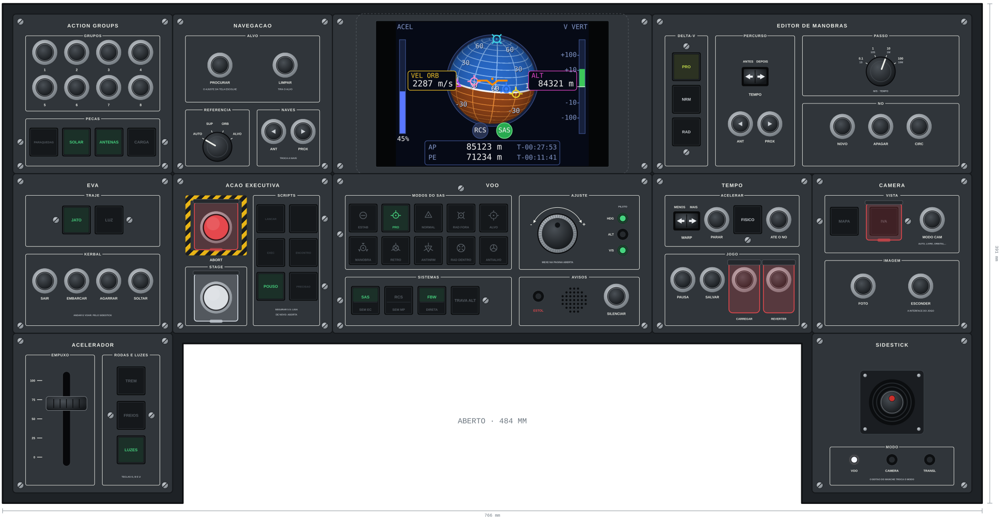
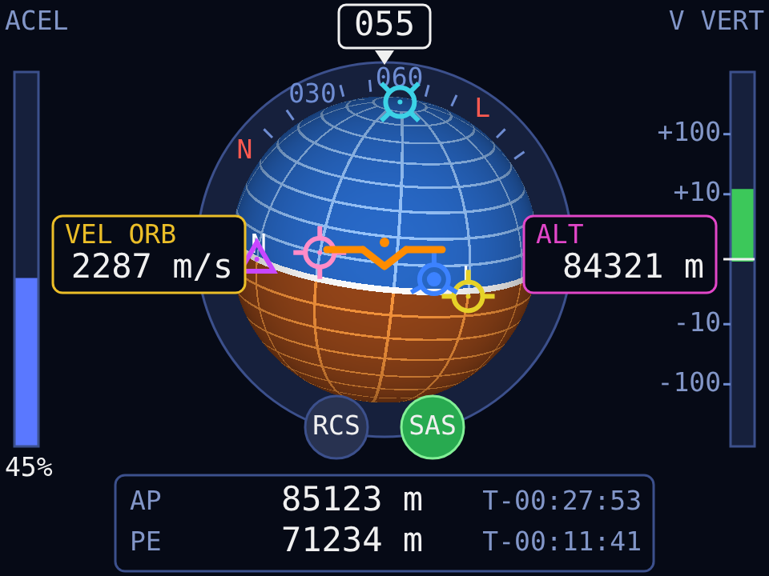

# KSP Cockpit

**English** · [Português](README.pt-BR.md)

A physical cockpit for **Kerbal Space Program 1**, built from scratch: panels of switches, illuminated korry buttons and LEDs, a sidestick and a throttle, a multifunction display on an old tablet, and flight scripts that fly a rocket to orbit, meet a space station or land a booster at the push of a button.

The main goal is to learn embedded firmware and electronics, and to end up with a real cockpit along the way.

<p align="center">
  
</p>

> [!NOTE]
> This is a fan project. It is not affiliated with or endorsed by Squad, Private Division or Take-Two Interactive. *Kerbal Space Program* is a trademark of Take-Two Interactive Software, Inc.

The code (names, comments and command-line options) and the detailed documentation are in Brazilian Portuguese. This page is the entry point in English.

## What works today

| Part | Status |
|---|---|
| **Flight computer** (Raspberry Pi 4, Python) | Working. Talks to the game over [kRPC](https://github.com/krpc/krpc) through a direct Ethernet cable, starts on boot and waits for the game. |
| **Multifunction display** | Runs with the game. Pages for the navball, SAS modes, autopilot, landing, ascent and a 3D orbit map. It is a web page on the tablet or on any phone, and also runs in a PC simulator and as bare-metal firmware on a mikromedia for ARM board. |
| **Ascent to orbit** ([`scripts/subida.py`](scripts/subida.py)) | Flown in the game: reached 80 and 100 km orbits on its own with a 552 t rocket. The gravity turn is still being tuned. |
| **Rendezvous** ([`scripts/rendezvous.py`](scripts/rendezvous.py)) | Flown in the game: from a 100 km orbit to 111 m from a space station, finishing on RCS translation. |
| **Suicide-burn landing** ([`scripts/pouso.py`](scripts/pouso.py)) | Being tested in the game. |
| **Fly-by-wire and autopilot for planes** ([`scripts/fbw.py`](scripts/fbw.py)) | Tested on a simulated plane, not yet in the game. |
| **Voice callouts**, like an airliner's GPWS ([`bridge/avisos.py`](bridge/avisos.py)) | Written and tested without the game; not yet heard on the Pi. |
| **Panel I/O** (Arduino Mega) | Phase 1 done: a button, an LED and an LCD in a closed loop with the game. The switches and LEDs of phase 2 are ready to assemble. |
| **Panel modules and backplane** (KiCad) | Schematics drawn. The PCB of the medium module is routed, with Gerbers. |
| **Korry switches** (OpenSCAD, 3D printed) | Designed, with STL files for every part and a clearance test piece. |
| **Enclosure** | Designed (11 panels of 125 mm in a U shape); nothing built yet. |

<p align="center">
  
</p>

## How it fits together

```
 Windows PC: KSP 1 + kRPC server
        ▲
        │ direct Ethernet cable (kRPC, TCP/protobuf)
        ▼
 Raspberry Pi 4, the flight computer ............. bridge/
   • bridge between kRPC and the boards
   • serves the multifunction display page
   • launches the flight scripts ................... scripts/
        ▲                          ▲
        │ USB serial               │ home Wi-Fi
        │ (own text protocol)      │ (HTTP, Server-Sent Events)
        ▼                          ▼
 Arduino Mega, panel I/O         tablet = multifunction display
 firmware/painel/                (Galaxy Tab S 8.4, in Chrome)
        ▲
        │ SPI (74HC165 / 74HC595) + analog lines
        ▼
 Backplane with 12 slots, one module per panel ... hardware/
   korry switches, buttons, LEDs, sidestick, throttle
```

One rule shapes the whole design: **a light shows the state of the game, not the position of a switch.** The panel only reports what was pressed. The flight computer asks the game, and the game's answer lights the korry, so the panel never disagrees with the game. The Mega does not know that KSP exists: it is a generic I/O panel that speaks a small text protocol (`BTN STAGE 1`, `SAS 1`, `ALT 12345`).

More in [docs/arquitetura.md](docs/arquitetura.md) and in the [decisions](docs/decisoes.md) (in Portuguese).

## Try it without hardware

All you need is Python 3.

```bash
git clone https://github.com/Schackschuck/ksp-cockpit.git
```

```bash
cd ksp-cockpit
```

```bash
pip install -r requirements.txt
```

The display with a simulated spacecraft that moves by itself:

```bash
python bridge/mfd.py --demo --celular
```

Open http://localhost:8000 for the display and http://localhost:8001 for the button panel. On the button panel, hold **LANCAR** for 5 s to fly a simulated rocket to orbit, or **POUSO** to land a simulated booster. Without `--celular`, the display opens in a window, at the resolution of the mikromedia board.

The flight scripts also run alone, against a simulated vehicle:

```bash
python scripts/subida.py --demo
```

```bash
python scripts/pouso.py --demo
```

The tests need neither the game nor the hardware (the flight scripts take about 3 minutes):

```bash
python -m unittest discover -s bridge/tests
```

```bash
python -m unittest discover -s scripts/tests
```

## With the game

1. Install KSP 1.12 and the kRPC mod, through CKAN or by hand. The project runs server 0.5.4 in the game and the Python client 0.6.0, the one in `requirements.txt`.
2. In the game, open the kRPC window and start the server. To connect from another computer, such as the Pi, set the address to **Any** and allow TCP ports 50000 and 50001 in the firewall.
3. Check the connection: `python bridge/fase0_altitude.py` prints the altitude live. From another computer, add the PC's IP address.
4. The display with the real ship: `python bridge/mfd.py --celular`. Flying to an 80 km orbit: `python scripts/subida.py`.

The full setup of the Raspberry Pi is in [docs/setup-pi.md](docs/setup-pi.md), and the first circuit with the Arduino Mega is in [docs/fase1.md](docs/fase1.md).

## Repository map

| Folder | What is inside |
|---|---|
| [`bridge/`](bridge/) | The flight computer in Python: the panel bridge, the display bridge and its simulator, the browser pages, the voice callouts, the maneuver editor and the systemd service |
| [`scripts/`](scripts/) | The flight scripts (ascent, rendezvous, landing, fly-by-wire). Each one runs alone from the command line |
| [`firmware/`](firmware/) | The Arduino Mega panel, the Arduino Uno encoder, the phase 1 learning sketches, and the display firmware for the mikromedia (LPC2148), written without a framework |
| [`hardware/`](hardware/) | KiCad schematics and PCB, the korry switch (OpenSCAD and STL), panel drawings generated by code, the visual identity and the enclosure |
| [`docs/`](docs/) | The detailed documentation, in Portuguese |
| [`.claude/`](.claude/) | The Claude Code workflow: skills, a hook and review agents |

## Documentation

The detailed documentation is in Portuguese; your browser's translator handles it well. The full index is in [docs/README.md](docs/README.md). Good places to start:

- [Architecture](docs/arquitetura.md), [decisions](docs/decisoes.md) and the [roadmap](docs/roteiro.md), in 8 phases
- [Serial protocol](docs/protocolo.md) between the flight computer, the boards and the display
- [Multifunction display](docs/mfd.md), with the simulator, the phone and the tablet
- [Flight scripts](docs/scripts-de-voo.md): [ascent](docs/subida.md), [rendezvous](docs/rendezvous.md), [fly-by-wire](docs/fbw.md) and [voice callouts](docs/avisos.md)
- [Hardware](hardware/README.md), the [korry switch](hardware/korry/README.md) and the [construction](hardware/construcao.md)

## Built with

- [kRPC](https://github.com/krpc/krpc) ([docs](https://krpc.github.io/krpc/)), which exposes the game to Python over the network
- Python, with [pySerial](https://pyserial.readthedocs.io/), [pygame-ce](https://pyga.me/) and NumPy
- [Arduino](https://docs.arduino.cc/) on the Mega and the Uno
- [LLVM](https://llvm.org/) (clang and ld.lld) for the ARM7 firmware, flashed with [Flash Magic](https://www.flashmagictool.com/). Register reference: the [LPC214x user manual (UM10139)](https://www.nxp.com/docs/en/user-guide/UM10139.pdf); board manual and schematic: [MikroElektronika](https://www.mikroe.com/) (MIKROE-780)
- [KiCad](https://www.kicad.org/) for the schematics and PCBs, [OpenSCAD](https://openscad.org/) for the korry switch, and Node.js for the panel drawings
- The [Raspberry Pi documentation](https://www.raspberrypi.com/documentation/)

The display firmware embeds bitmaps of the [DejaVu Sans Mono](https://dejavu-fonts.github.io/) font, in `firmware/mfd/tabelas.c`, under the [DejaVu fonts license](https://dejavu-fonts.github.io/License.html).

## How it is developed

The project is developed with [Claude Code](https://claude.com/claude-code): one agent writes a plan and reviews, another implements, and every change is checked (tests, pyflakes and firmware builds) before it is merged. The rules are in [`CLAUDE.md`](CLAUDE.md), and the skills, the hook and the review agents are in [`.claude/`](.claude/).

## License

[MIT](LICENSE) © 2026 Arthur Schuck
