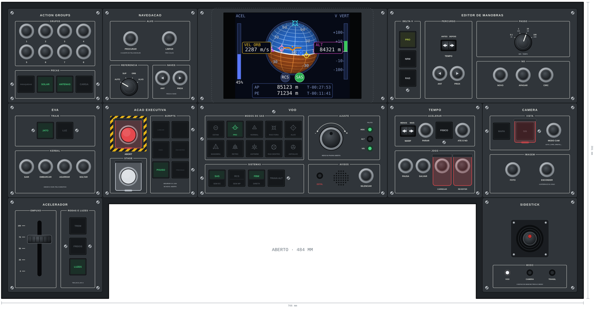
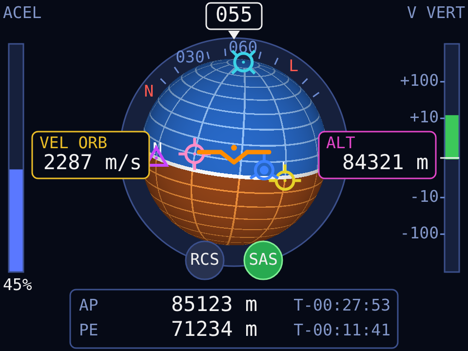

# KSP Cockpit

[English](README.md) · **Português**

Um cockpit físico para o **Kerbal Space Program 1**, feito do zero: painéis com chaves, korry (botões iluminados de avião) e LEDs, um sidestick e um acelerador, uma tela multifunção num tablet velho e scripts de voo que levam um foguete até a órbita, encontram uma estação espacial ou pousam um booster com um botão.

O objetivo principal é aprender firmware, embarcados e eletrônica, e de quebra ter um cockpit de verdade.

<p align="center">
  
</p>

> [!NOTE]
> Este é um projeto de fã. Não tem ligação com a Squad, a Private Division ou a Take-Two Interactive, nem o apoio delas. *Kerbal Space Program* é marca da Take-Two Interactive Software, Inc.

## O que já funciona

| Parte | Situação |
|---|---|
| **Computador de bordo** (Raspberry Pi 4, Python) | Funcionando. Fala com o jogo pelo [kRPC](https://github.com/krpc/krpc), por um cabo de rede direto, abre sozinho quando o Pi liga e espera o jogo. |
| **Tela multifunção** | Roda com o jogo. Páginas da navball, dos modos do SAS, do piloto automático, do pouso, da subida e do mapa da órbita em 3D. É uma página web no tablet ou em qualquer celular, e roda também num simulador no PC e num firmware sem framework na placa mikromedia for ARM. |
| **Subida até a órbita** ([`scripts/subida.py`](scripts/subida.py)) | Voou no jogo: chegou sozinho em órbitas de 80 e 100 km, com um foguete de 552 t. O giro da curva de gravidade ainda está em ajuste. |
| **Rendezvous** ([`scripts/rendezvous.py`](scripts/rendezvous.py)) | Voou no jogo: de uma órbita de 100 km até 111 m de uma estação espacial, com a aproximação final pelo RCS de translação. |
| **Pouso com queima de suicídio** ([`scripts/pouso.py`](scripts/pouso.py)) | Em teste no jogo. |
| **Fly by wire e piloto automático de avião** ([`scripts/fbw.py`](scripts/fbw.py)) | Testado num avião simulado; falta testar no jogo. |
| **Avisos por voz**, como o GPWS dos aviões de linha ([`bridge/avisos.py`](bridge/avisos.py)) | Escrito e testado sem o jogo; falta ouvir no Pi. |
| **I/O do painel** (Arduino Mega) | Fase 1 concluída: um botão, um LED e um LCD em circuito fechado com o jogo. As chaves e os LEDs da fase 2 estão prontos para montar. |
| **Módulos do painel e backplane** (KiCad) | Esquemáticos prontos. A PCB do módulo médio está roteada, com os Gerbers. |
| **Korry** (OpenSCAD, impresso em 3D) | Desenhado, com os STL de todas as peças e uma peça de teste de folga. |
| **Caixa** | Desenhada (11 painéis de 125 mm, em U); nada construído ainda. |

<p align="center">
  
</p>

## Como as partes se ligam

```
 PC com Windows: KSP 1 + servidor kRPC
        ▲
        │ cabo de rede direto (kRPC, TCP/protobuf)
        ▼
 Raspberry Pi 4, o computador de bordo ........... bridge/
   • ponte entre o kRPC e as placas
   • serve a página da tela multifunção
   • dispara os scripts de voo ..................... scripts/
        ▲                          ▲
        │ USB/serial               │ Wi-Fi de casa
        │ (protocolo próprio)      │ (HTTP, Server-Sent Events)
        ▼                          ▼
 Arduino Mega, I/O do painel     tablet = tela multifunção
 firmware/painel/                (Galaxy Tab S 8.4, no Chrome)
        ▲
        │ SPI (74HC165 / 74HC595) + linhas analógicas
        ▼
 Backplane de 12 slots, um módulo por painel ..... hardware/
   korry, botões, LEDs, sidestick, acelerador
```

Uma regra guia o projeto inteiro: **a luz mostra o estado do jogo, não a posição da chave.** O painel só avisa o que foi apertado. O computador de bordo pede ao jogo, e a resposta do jogo acende o korry, então o painel nunca discorda do jogo. O Mega não sabe que o KSP existe: é um painel de I/O genérico, que fala um protocolo pequeno em texto (`BTN STAGE 1`, `SAS 1`, `ALT 12345`).

Mais em [docs/arquitetura.md](docs/arquitetura.md) e nas [decisões](docs/decisoes.md).

## Testar sem hardware

Só precisa do Python 3.

```bash
git clone https://github.com/Schackschuck/ksp-cockpit.git
```

```bash
cd ksp-cockpit
```

```bash
pip install -r requirements.txt
```

A tela, com uma nave de mentira que se mexe sozinha:

```bash
python bridge/mfd.py --demo --celular
```

Abra http://localhost:8000 para a tela e http://localhost:8001 para a página de botões. Na página de botões, segure o **LANCAR** 5 s para um foguete simulado subir até a órbita, ou o **POUSO** para um booster simulado pousar. Sem o `--celular`, a tela abre numa janela, na resolução da mikromedia.

Os scripts de voo também rodam sozinhos, com uma nave simulada:

```bash
python scripts/subida.py --demo
```

```bash
python scripts/pouso.py --demo
```

Os testes não precisam do jogo nem do hardware (os dos scripts de voo levam uns 3 minutos):

```bash
python -m unittest discover -s bridge/tests
```

```bash
python -m unittest discover -s scripts/tests
```

## Com o jogo

1. Instale o KSP 1.12 e o mod kRPC, pelo CKAN ou na mão. O projeto usa o servidor 0.5.4 no jogo e o cliente Python 0.6.0, o do `requirements.txt`.
2. No jogo, abra a janela do kRPC e inicie o servidor. Para conectar de outro computador, como o Pi, troque o endereço para **Any** e libere no firewall as portas TCP 50000 e 50001.
3. Confira a conexão: `python bridge/fase0_altitude.py` imprime a altitude ao vivo. De outro computador, acrescente o IP do PC.
4. A tela com a nave de verdade: `python bridge/mfd.py --celular`. Subir até uma órbita de 80 km: `python scripts/subida.py`.

A preparação completa do Raspberry Pi está em [docs/setup-pi.md](docs/setup-pi.md), e o primeiro circuito com o Arduino Mega, em [docs/fase1.md](docs/fase1.md).

## Mapa do repositório

| Pasta | O que tem |
|---|---|
| [`bridge/`](bridge/) | O computador de bordo em Python: a ponte do painel, a ponte da tela e o simulador, as páginas do navegador, os avisos por voz, o editor de manobras e o serviço do systemd |
| [`scripts/`](scripts/) | Os scripts de voo (subida, rendezvous, pouso, fly by wire). Cada um roda sozinho pela linha de comando |
| [`firmware/`](firmware/) | O painel no Arduino Mega, o encoder no Arduino Uno, os sketches de aprendizado da fase 1 e o firmware da tela na mikromedia (LPC2148), escrito sem framework |
| [`hardware/`](hardware/) | Esquemáticos e PCB no KiCad, o korry (OpenSCAD e STL), os desenhos dos painéis gerados por código, a identidade visual e a caixa |
| [`docs/`](docs/) | A documentação detalhada |
| [`.claude/`](.claude/) | O fluxo do Claude Code: skills, um hook e agentes revisores |

## Documentação

O índice completo está em [docs/README.md](docs/README.md). Bons pontos de partida:

- [Arquitetura](docs/arquitetura.md), [decisões](docs/decisoes.md) e o [roteiro](docs/roteiro.md), em 8 fases
- [Protocolo serial](docs/protocolo.md) entre o computador de bordo, as placas e a tela
- [Tela multifunção](docs/mfd.md), com o simulador, o celular e o tablet
- [Scripts de voo](docs/scripts-de-voo.md): [subida](docs/subida.md), [rendezvous](docs/rendezvous.md), [fly by wire](docs/fbw.md) e [avisos por voz](docs/avisos.md)
- [Hardware](hardware/README.md), o [korry](hardware/korry/README.md) e a [construção](hardware/construcao.md)

## Feito com

- [kRPC](https://github.com/krpc/krpc) ([documentação](https://krpc.github.io/krpc/)), que abre o jogo para o Python pela rede
- Python, com [pySerial](https://pyserial.readthedocs.io/), [pygame-ce](https://pyga.me/) e NumPy
- [Arduino](https://docs.arduino.cc/) no Mega e no Uno
- [LLVM](https://llvm.org/) (clang e ld.lld) para o firmware do ARM7, gravado com o [Flash Magic](https://www.flashmagictool.com/). Referência dos registradores: o [manual do LPC214x (UM10139)](https://www.nxp.com/docs/en/user-guide/UM10139.pdf); manual e esquemático da placa: [MikroElektronika](https://www.mikroe.com/) (MIKROE-780)
- [KiCad](https://www.kicad.org/) para os esquemáticos e as PCBs, [OpenSCAD](https://openscad.org/) para o korry e Node.js para os desenhos dos painéis
- A [documentação do Raspberry Pi](https://www.raspberrypi.com/documentation/)

O firmware da tela traz os bitmaps da fonte [DejaVu Sans Mono](https://dejavu-fonts.github.io/), em `firmware/mfd/tabelas.c`, sob a [licença das fontes DejaVu](https://dejavu-fonts.github.io/License.html).

## Como é desenvolvido

O projeto é desenvolvido com o [Claude Code](https://claude.com/claude-code): um agente escreve o plano e revisa, outro implementa, e cada mudança é verificada (testes, pyflakes e compilação dos firmwares) antes do merge. As regras ficam no [`CLAUDE.md`](CLAUDE.md), e as skills, o hook e os revisores, em [`.claude/`](.claude/).

## Licença

[MIT](LICENSE) © 2026 Arthur Schuck
